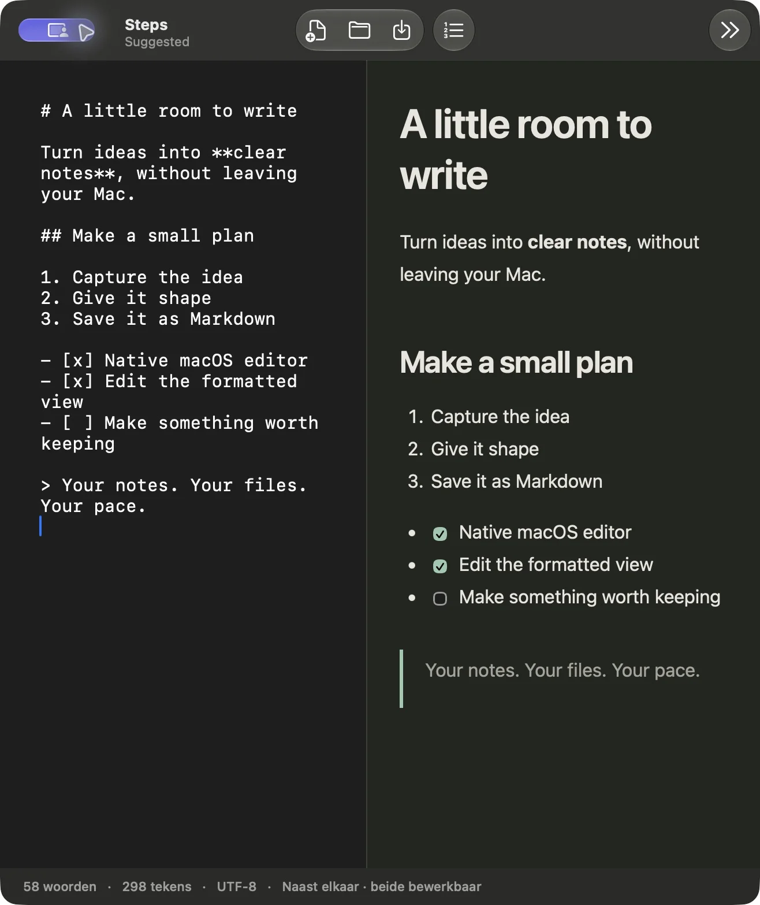

<div align="center">

# Markeer

**A little room to write.**

A native Markdown editor for macOS. Write in plain text, edit the formatted view, or keep both side by side — while your notes stay ordinary `.md` files.

[Download for Mac](https://github.com/jseverijn3k/Markeer/releases/latest) · [Project page](https://jefflabs.co/projects/markeer/) · [Report an issue](https://github.com/jseverijn3k/Markeer/issues)

</div>



## Your notes, your files

Markeer is built for the small things that deserve a clear place: a draft, meeting notes, a project plan, a README. Open a file, start writing, and switch views whenever it helps.

The app uses Apple's AppKit and WebKit. It needs no account, subscription, cloud service, Electron, or separate runtime. Documents remain local files you can move, back up, version with Git, or open in another editor. Remote images referenced in a document load from their original URLs.

## Three ways to write

| View | What you can do | Shortcut |
| --- | --- | --- |
| Markdown | Edit the source in a native, monospaced text editor. | `⌘1` |
| Formatted | Write directly in the rendered document. | `⌘2` |
| Side by side | Keep both editable views open with changes reflected between them. | `⌘3` |

Switching views alone preserves the original Markdown. When you edit formatted text, changed blocks are converted back to Markdown; untouched blocks keep their original syntax. Formatting and whitespace within edited blocks may be normalized.

## What is included

- Native document windows, tabs, open/save dialogs, autosave, and dark mode.
- Headings, bold and italic text, links, blockquotes, and fenced code blocks.
- Bullet lists, **numbered lists**, checkboxes, and tables.
- A dedicated numbered-list toolbar button for both editors. In source mode it numbers the selected lines, or the current line when nothing is selected.
- Formatting actions in the toolbar and menu, plus keyboard shortcuts.
- Local images resolved relative to the saved document's folder.
- Word and character counts; search in the Markdown editor.
- UTF-8 documents, with import support for UTF-16 files containing a byte-order mark.

The current interface labels are in Dutch. The document itself can be written in any language.

## Install

**Apple Silicon · macOS 13 or later**

1. Download the latest `.dmg` from [Releases](https://github.com/jseverijn3k/Markeer/releases/latest).
2. Open the disk image and drag **Markeer** into **Applications**.
3. Launch Markeer and open or create a Markdown file.

The current release is ad-hoc signed and is not notarized by Apple. Intel builds are not included.

## Keyboard shortcuts

| Action | Shortcut |
| --- | --- |
| New / Open / Save | `⌘N` / `⌘O` / `⌘S` |
| Save as | `⌘⇧S` |
| Next view | `⌘⇧P` |
| Bold / Italic / Link | `⌘B` / `⌘I` / `⌘K` |
| Heading / Bullet list | `⌘⇧H` / `⌘⇧L` |
| Numbered list | `⌘⇧O` |
| Find in Markdown | `⌘F` |
| Open a link in the formatted view | `⌘`-click |

## Build from source

You need an Apple Silicon Mac, Xcode Command Line Tools, and CMake. Node.js and npm are needed only for the DOM editor tests.

```bash
git clone https://github.com/jseverijn3k/Markeer.git
cd Markeer
./build.sh
```

The app and ZIP are written to `dist/`. The Markdown parser is vendored, so building the app does not fetch dependencies.

Run the complete automated suite:

```bash
./Tests/run.sh
```

The test runner builds the app, runs the Swift checks, and installs the pinned jsdom dependency in `.build/` before running the editor checks. See [PROJECT.md](PROJECT.md) for architecture and verification notes.

## Current scope

Markeer began as a personal alternative to MacDown's core writing workflow. It adds direct editing in the formatted view, but it does **not** yet reproduce every MacDown feature.

TeX/math rendering, Jekyll front-matter handling, code syntax highlighting, Markdown auto-completion, and an extensive rendering-preferences panel are not implemented. Raw HTML is displayed as literal code instead of executed. Search is currently available in source mode.

## Built with

- **Swift + AppKit** for native document management and source editing.
- **WebKit** for the formatted editor.
- **cmark-gfm** for CommonMark and GitHub Flavored Markdown rendering.
- **Turndown** and its GFM plugin for HTML-to-Markdown conversion.

Third-party copyright and license notices are included in [THIRD_PARTY_NOTICES.md](THIRD_PARTY_NOTICES.md) and alongside the bundled components.

Made at [JeffLabs](https://jefflabs.co).
